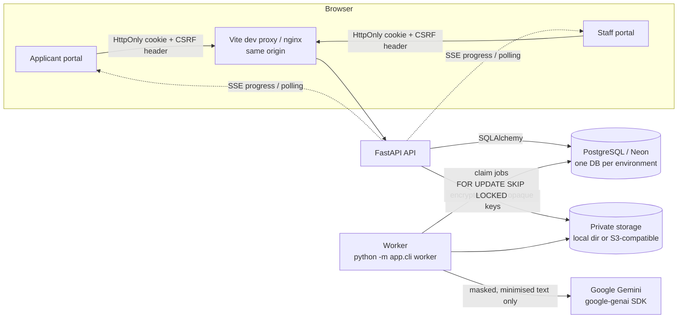
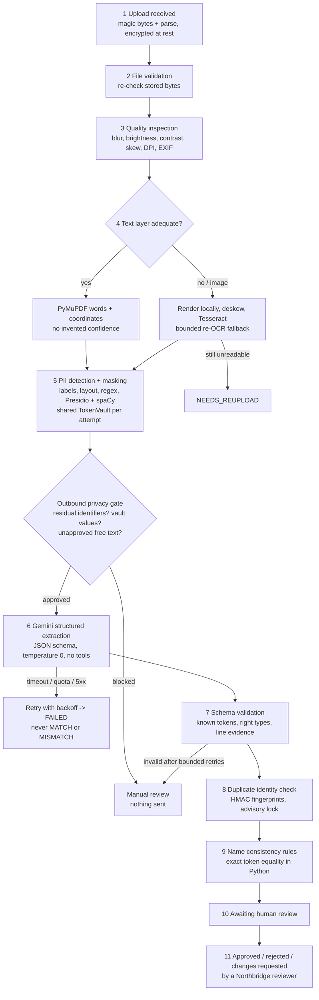
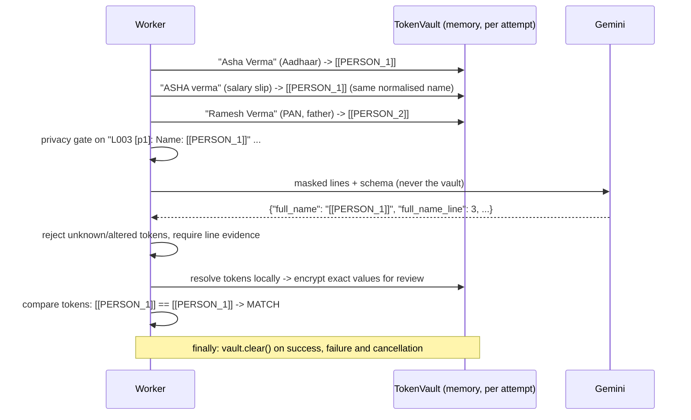
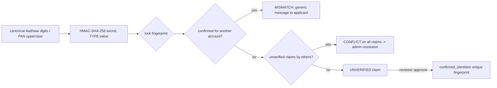

# Architecture

## System overview



* The **API** never processes documents inline. Submission enqueues a durable job (`processing_jobs`).
* The **worker** owns all raw-document handling: decrypting the file, OCR, PII detection and the Gemini call.
  Raw text and the token vault exist only in worker memory for one processing attempt.
* The browser talks to one origin; the API is proxied, so the session cookie stays first-party (`SameSite=Lax`)
  and CORS stays restricted to `ALLOWED_ORIGINS`.

## Processing pipeline (one application version attempt)



Every numbered stage writes a `processing_events` row (ID, version ID, attempt, stage, status, fixed message).
The browser receives them over authenticated SSE (resumable with `Last-Event-ID`) or by polling, so a refresh
reloads the full history.

## Token vault and the Gemini boundary



Gemini classifies the document and copies tokens into the schema. It never sees raw text, full identifiers or
the mapping, and it never decides whether names match or whether to approve.

## Status model (three independent fields)

| Field | Values | Set by |
|---|---|---|
| `processing_status` | NOT_STARTED, QUEUED, RUNNING, SUCCEEDED, FAILED, NEEDS_REUPLOAD | worker |
| `check_status` | MATCH, MISMATCH, INCOMPLETE (per-check also NOT_APPLICABLE) | deterministic rules |
| `review_status` | NOT_READY, PENDING_REVIEW, APPROVED, REJECTED, CHANGES_REQUESTED | reviewer |

A processing failure leaves `check_status` empty. Approval requires `SUCCEEDED + MATCH + PENDING_REVIEW`, the
current version, the expected `row_version`, and no unresolved identity conflicts. A partial unique index allows
only one final decision per version.

## Versioning and resubmission

Submitted versions are immutable. "Start a correction" creates version *n+1* (documents re-encrypted under new
keys), marks *n* as `SUPERSEDED` and not current, and all approval paths reject non-current versions or stale
`row_version` values.

## Identity duplicates



OCR-uncertain or format-implausible identifiers create `UNTRUSTED` claims that reserve nothing, so a bad first
upload cannot lock out the real holder. Names never determine duplication.

## Data classes

| Class | Examples | Where | Lifetime |
|---|---|---|---|
| Transient processing | raw OCR text, token vault, decrypted bytes | worker memory | one attempt (references dropped in `finally`; physical memory zeroisation is not guaranteed by Python) |
| Review data | original files, exact extracted values, identity names | encrypted blobs; `*_enc` columns (AES-256-GCM) | originals purged N days after decision (configurable); encrypted values kept for audit |
| Telemetry | stage, status, durations, error class, counts | logs / OTel spans | allowlisted keys only |

## Repository layout

```
backend/app/api            HTTP routes (auth, applications, documents, staff/admin)
backend/app/auth           passwords, sessions, authorisation dependencies
backend/app/models         SQLAlchemy models and enums
backend/app/schemas        Pydantic request/response models
backend/app/services       audit, identity, notifications, retention, status text, views
backend/app/pipeline       validation, quality, OCR, PII/vault/gate, LLM providers, output validation, matching
backend/app/workers        durable queue and worker runner
backend/app/storage        encrypted blob storage adapters
backend/app/observability  allowlisted logging and tracing
backend/alembic            migrations (0001 schema, 0002 seed organisation)
backend/tests              pytest suite
frontend/                  React + TypeScript + Vite + Tailwind + shadcn/ui
tests/e2e                  Playwright journey
scripts/                   samples, evaluation, E2E helpers
samples/                   synthetic documents + manifest
docs/                      this documentation, OpenAPI export, evaluation results
```
